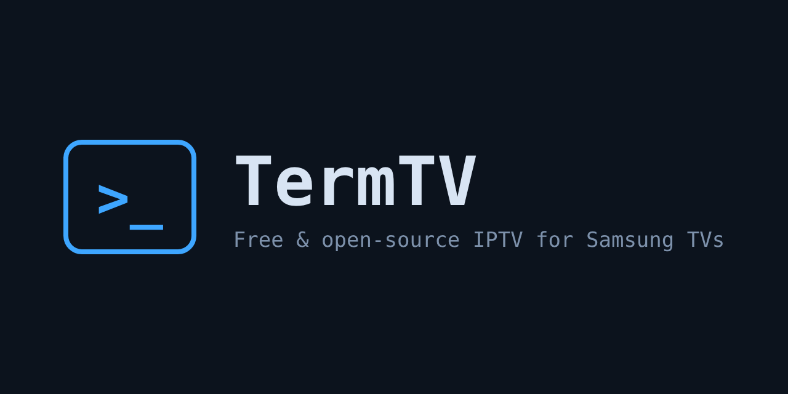
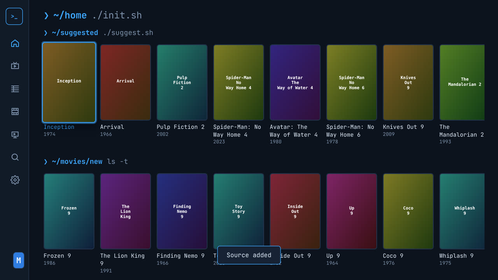
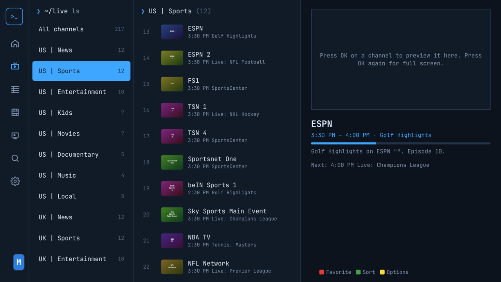
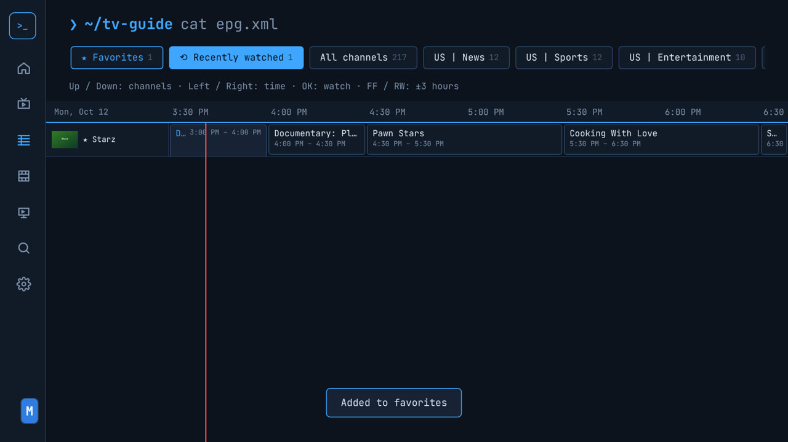
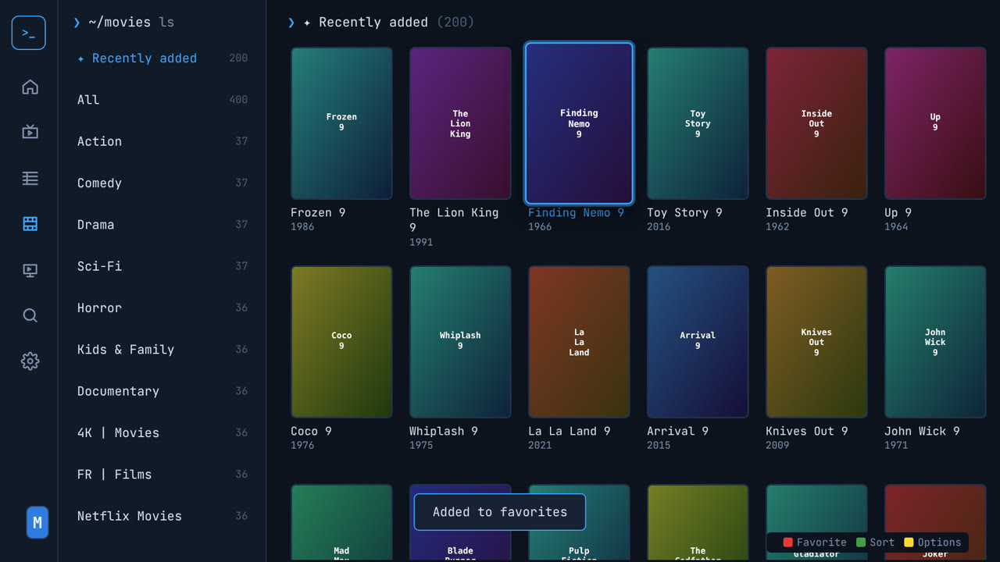
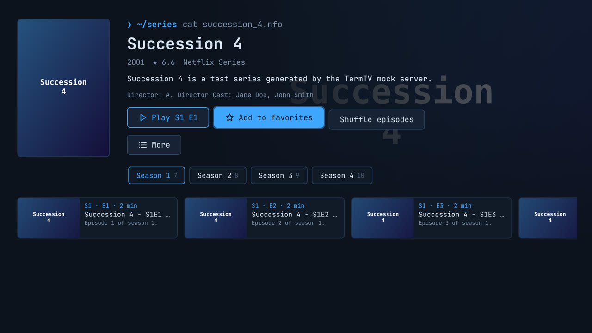
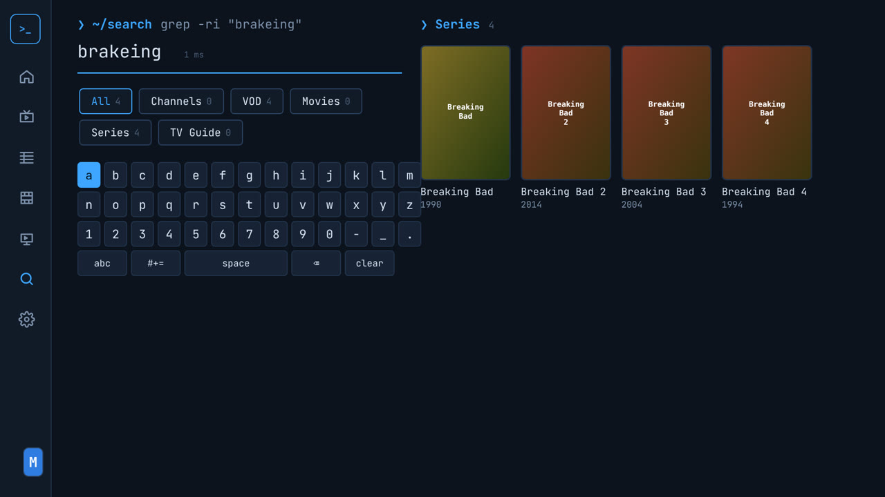
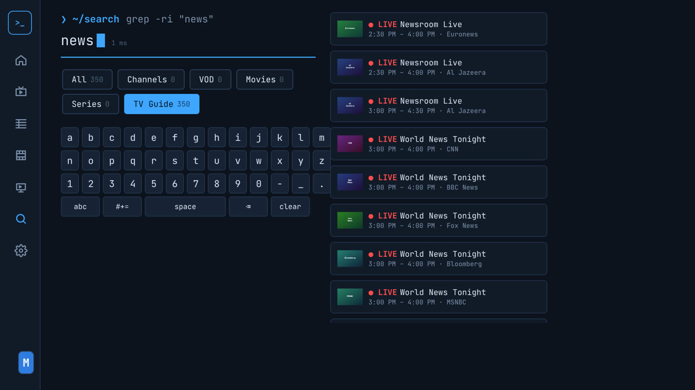
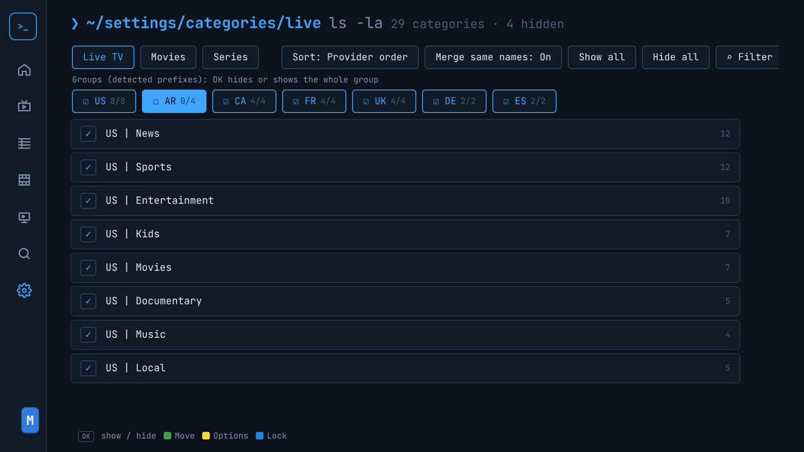
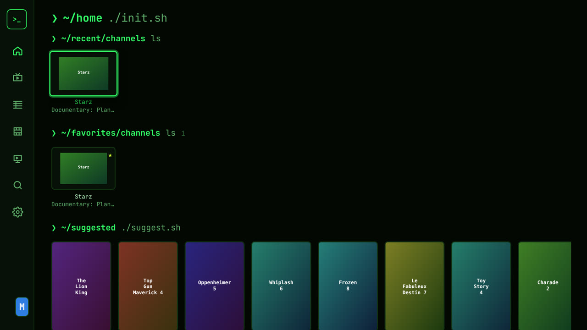

<div align="center">



**A free, open-source IPTV player for Samsung Smart TVs (Tizen, 2018 and newer).**
Bring your own Xtream Codes account or M3U playlist. No account, no ads, no tracking: everything stays on your TV.

</div>

> **Status: alpha.** Everything below is implemented and tested in a desktop browser against the bundled mock provider. It has **not yet been tested on a real Samsung TV.** Please report what works and what doesn't on your model.

## Screenshots

| | | |
|:--:|:--:|:--:|
| <br><sub>Home</sub> | <br><sub>Live TV</sub> | <br><sub>TV Guide</sub> |
| <br><sub>Movies</sub> | <br><sub>Series</sub> | <br><sub>Search (typo-tolerant)</sub> |
| <br><sub>Search the TV guide</sub> | <br><sub>Manage categories</sub> | <br><sub>Themes</sub> |

## Features

- **Sources**: Xtream Codes (server / username / password) and M3U / M3U8 playlists. Add several; they merge into one library. Pasting a `get.php?username=…` link is detected as Xtream automatically.
- **Live TV**: categories, channel list with what's on now, live preview window, channel up/down, number entry, favorites, recently watched, auto-reconnect on stalls.
- **TV Guide**: full timeline grid with a NOW line, ±3 h jumps, from XMLTV (gzip supported) or the Xtream guide.
- **Movies & Series**: posters, details, resume / play from the beginning, seasons and episodes, auto-play next episode, shuffle, "versions" when the same title exists in several sources or qualities.
- **Category management**, per section (Live TV, Movies, Series):
  - sort: provider order, A → Z, Z → A, custom (move up / down / top / bottom, or pick up and move), most watched;
  - hide / show one by one, **all categories with the same prefix at once** (`AR | …`, `FR | …`), or everything matching a filter;
  - merge categories with the same name across sources;
  - choices survive playlist refreshes, even when the provider renumbers its categories;
  - new categories after a refresh are flagged NEW, and can be hidden automatically.
- **Search**, built for messy IPTV names:
  - scopes: **All · Channels · VOD · Movies · Series · TV Guide**;
  - results while typing, any word order, accents and punctuation ignored (`amelie` → *Amélie*, `spiderman` → *Spider-Man*);
  - typos tolerated (`brakeing bad` → *Breaking Bad*), words found inside others (`man` → *Batman*);
  - quality tags and prefixes understood (`US | CNN ᴴᴰ` matches `cnn`), channel numbers (`206`);
  - duplicates (same movie in FHD and 4K, or in two sources) merged into one result;
  - hidden categories and parental locks respected; favorites and recently watched ranked first;
  - runs in a background worker: ~1-30 ms per key press on 100k titles.
- **Profiles**: "Who's watching?", optional PIN per profile, separate favorites, lists, history and settings.
- **Favorite lists**: your own named lists of channels, movies and series, each with its own Home row.
- **Parental controls**: lock categories with a PIN; locked content is hidden or PIN-gated.
- **Player**: Samsung's native AVPlay engine (hardware decoding of HLS, MPEG-TS, MP4, MKV), with an HTML5 fallback (hls.js / mpegts.js). Audio and subtitle tracks, subtitle style (size, color, background, position), preferred languages, aspect ratio.
- **Themes**: Midnight Shell, Matrix Green, Amber CRT, Purple Cyber, Synthwave, Paper (light).
- **Backup & restore** to a USB drive.
- **Translations**: English for now; adding a language is one JSON file (see [CONTRIBUTING.md](CONTRIBUTING.md)).

## Install on a Samsung TV

TermTV is distributed as a signed `.wgt` package that you **sideload** on your TV (developer mode). Step-by-step guide: **[docs/INSTALL.md](docs/INSTALL.md)**.

Supported: Samsung Smart TVs from **2018** on (Tizen 4.0+).

## Remote control

| Key | Action |
|---|---|
| Arrows / OK | Navigate / select |
| Back | Back (on Home: sidebar, then exit) |
| 🔴 Red | Add / remove favorite |
| 🟢 Green | Sort (lists) · Move (category manager) · Aspect ratio (player) |
| 🟡 Yellow | Options menu · Audio & subtitles (player) |
| 🔵 Blue | Lock category (category manager) |
| CH + / CH − | Change channel · page up / down in lists |
| 0-9 | Channel number (player) · type in search |
| ▶ ❚❚ ◀◀ ▶▶ | Playback · ±30 s · ±3 h in the guide |
| Guide | TV Guide |

## Development

Requirements: Node.js 18+. Works in any desktop Chromium-based browser (keyboard = remote: arrows, Enter, Esc = Back, F1-F4 = color keys, F9 = Info).

```bash
npm install
npm run mock     # fake IPTV provider on :8090 (user demo / pass demo), generates test media with ffmpeg
npm run dev      # app on http://localhost:5173 (with a proxy for provider requests)
npm run check    # typecheck + unit tests + build + ES2017 output check
node scripts/e2e.mjs   # walk through every screen in headless Chromium, screenshots in screenshots/
```

Architecture and design notes: [docs/ARCHITECTURE.md](docs/ARCHITECTURE.md).

## License

[GPL-3.0](LICENSE). TermTV is free software: use it, share it, change it. Forks must stay open source.

Bundled: Preact (MIT), hls.js (Apache-2.0), mpegts.js (Apache-2.0), fflate (MIT), JetBrains Mono (OFL-1.1).

**Disclaimer:** TermTV is a media player. It does not provide, host or link to any content. You need your own playlist or subscription, and you are responsible for what you play.
